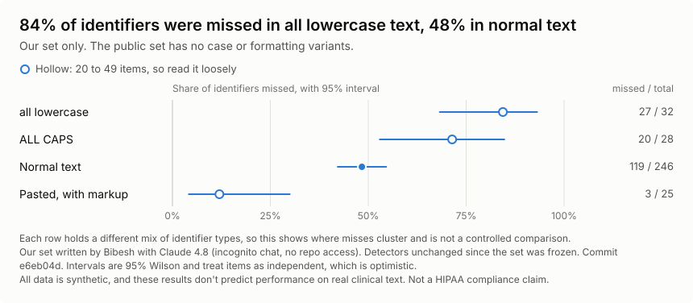
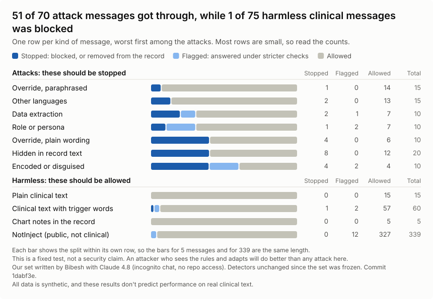

# How ScrubX is tested

It's easy to make a detector look good: write the test after the rules, then tune until it passes. This evaluation is built to make that hard. The test rows were written away from the code and committed before anything was scored, and the first score was published whatever it said.

It said ScrubX [misses about half of the identifiers and most of the attacks](../README.md#how-well-it-works).

**[Read the full results →](RESULTS.md)** Every miss is listed by row, and the numbers are also in [a spreadsheet](../docs/eval/eval-results.csv).

## Where it misses

The root README shows misses by identifier type. Here are two more views.

**By text style.** Misses are heaviest in text without normal capitalization: 84% in all lowercase and 71% in all caps, against 48% in normal text.

<picture>
  <source media="(prefers-color-scheme: dark)" srcset="../docs/eval/phi-by-shape-dark.svg">
  
</picture>

**By kind of attack.** The rules know the usual wording, so rephrasing beats them. Paraphrased overrides got through 14 times out of 15, and attacks in other languages 13 out of 15.

<picture>
  <source media="(prefers-color-scheme: dark)" srcset="../docs/eval/injection-outcomes-dark.svg">
  
</picture>

## How the test stays honest

- **The rows are written away from the code.** [A written plan](AUTHORING_PROMPT.md) goes into a chat with no access to this repo. Labels are corrected only where they break the plan's rules, and a row is never dropped for being hard.
- **The rows come before the score.** Scoring refuses to run until the rows and their hashes are committed, so `git log` proves the order.
- **The report labels itself.** It says "untuned" only while the detectors match the code the rows were frozen against. After any change, it calls them development scores.
- **Public sets check our own.** [ASQ-PHI and NotInject](external/README.md) are scored separately and never pooled with our rows.

This doesn't make the test fully independent. The same person wrote the detectors and directed the rows, and no independent person has checked the labels.

## How it's scored

- **A partly masked name is a miss.** A value counts as caught only if every letter and digit is masked.
- **A block isn't a catch.** A blocked message sends no prompt, so it's scored from its labels. Otherwise a block would look like no leak.
- **Masking everything doesn't help.** Precision is reported for each label, and any new false label fails CI.
- **Small groups get no percentage.** Every rate shows its count and a 95% interval, and under 20 items it shows only the count.

## Run it

```bash
npm run eval             # score everything and print the report
npm run eval -- --check  # the same check CI runs
```

It runs offline in a few seconds. On every pull request, CI compares each item to the committed results, with no margin. The same rows and the same code give the same result, so any difference is a real change.

A green check means nothing got worse. It doesn't mean ScrubX is good: today's failures are recorded as expected, so they pass until someone fixes them.

## Learn more

- **[Running the evaluation](RUNNING.md):** every command, what fails CI, and the order of work for writing rows.
- **[Public test sets](external/README.md):** sources, licences and how they were converted.
- **[Decision 18](../docs/decisions/18-an-honest-evaluation-set.md):** why it works this way, and what it costs.
